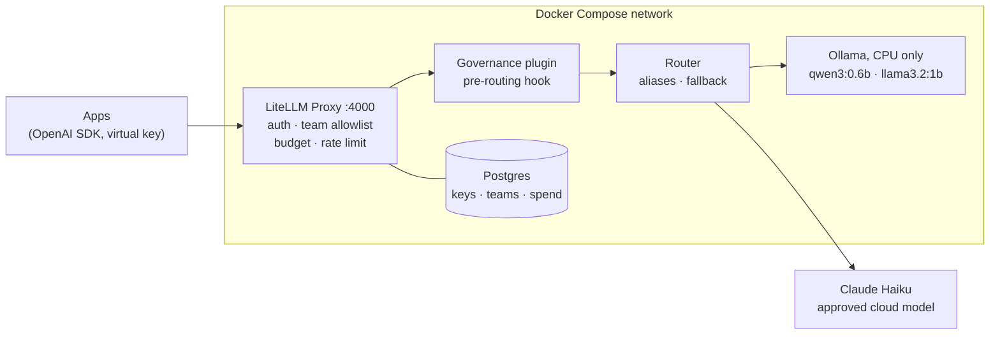

# LLM Gateway & Governance

A governed LLM gateway for a regulated lender, small enough to run on one laptop. Every application call goes through one OpenAI-compatible entry point that enforces team model allowlists, budgets, rate limits and internal chargeback pricing, and never stores prompts or responses. PII data-residency routing is next.

The demo organization is **Demo Mortgage Co.**, a fictional lender. The models are deliberately tiny and run CPU-only: the point is the controls around them, not the answers.

> **Status:** phases P0–P3 complete (cloud billing reconciliation against the provider console pending). P4 PII guardrails in progress. Each claim below is backed by a check script whose results are committed under [`docs/`](docs/).

## Why

Banks and lenders adopting LLMs face the same questions: Can applications bypass the approved path? Can customer data reach an unapproved vendor? Who spent what? Are prompts sitting in a log somewhere? This project answers each of those with a working control and a repeatable test.

## Architecture



Only the gateway publishes a port, bound to `127.0.0.1:4000`. Ollama and Postgres are reachable only inside the container network, so applications cannot call a model directly.

## What is verified

| Control | How it is tested | Result |
| --- | --- | --- |
| Gateway is the only path to models | Bypass test: direct host connections to Ollama and Postgres | Refused |
| OpenAI-compatible | Official OpenAI Python SDK, changing only `base_url`; streaming | Pass |
| Model aliases and fallback | Apps call `chat-default`; forced failure falls back to `chat-fallback`. No fallback between local and cloud | Pass |
| No prompt or response storage | Canary string sent (local and cloud); searched full database dump and all container logs | Not found |
| Team model allowlists | `underwriting` (handles customer PII) is local-only; its call to `chat-cloud` | HTTP 403 |
| Budgets | Key with a tiny budget keeps calling | Blocked with HTTP 422; overspend at most one call |
| Rate limits | 5 requests per minute | 6th request returns HTTP 429 |
| Internal chargeback | Local models priced per CPU-hour, converted from measured throughput; spend log = tokens × price | 12/12 rows exact; fallback billed at the model actually used |
| Cloud cost tracking | Gateway cost = provider-reported tokens × list price | Pass; console reconciliation pending |
| Locked model parameters | Plugin drops app-supplied controlled params (e.g. sampling params on Haiku, `reasoning_effort` on qwen3) so config wins | Pass; qwen3 thinking off: 4.8 s → 0.2 s |
| Secrets handling | Compose secrets at `/run/secrets`; checked `docker inspect`, `docker compose config` and full git history | No plaintext found; push protection on |
| Admin access | Shared master-key UI login disabled; named admin with own password | Pass |
| Persistence | Teams, keys, budgets and spend after restart | Preserved |
| Supply chain | All images pinned by version and sha256 digest; LiteLLM from the official image only, not PyPI | Pass |

**A bug found along the way:** Ollama returns short response IDs (`chatcmpl-<0..999>`), while LiteLLM's spend log uses the response ID as its primary key and skips duplicates. By about 40 requests a collision becomes roughly 50% likely, and spend rows were silently dropped. The governance plugin now rewrites those IDs to unique ones, and a test confirms N requests produce exactly N spend rows.

## Roadmap

| Phase | Scope | Status |
| --- | --- | --- |
| P0 | Isolated WSL2 + Docker Engine environment, snapshot and restore | Done |
| P1 | Model layer: Ollama, pinned models, performance baseline | Done |
| P2 | Gateway core: LiteLLM + Postgres, aliases, fallback, bypass test, no-content logging | Done |
| P3 | Governance: teams, allowlists, budgets, rate limits, chargeback, cloud model, Compose secrets | Done (reconciliation pending) |
| P4 | PII data-residency routing: Presidio with Canadian SIN (Luhn) and postal-code recognizers; block / reroute / redact by provider jurisdiction; fail-closed; audit table | In progress |
| P5 | One-command demo, reset, offline mode, architecture decision records | Planned |

## Quick start

Requires Linux or WSL2 with Docker Engine, Docker Compose and Python 3.

```bash
git clone https://github.com/javabbgit/llm-gateway-governance.git
cd llm-gateway-governance
bash scripts/gen-secrets.sh        # creates .secrets/ (git-ignored); Anthropic key optional
docker compose up -d
bash scripts/pull-models.sh        # pulls the pinned local models
python3 scripts/p3check.py org     # creates teams and keys from governance/org.toml
python3 scripts/p3check.py access  # verifies team allowlists
```

Call it like any OpenAI endpoint, using a virtual key:

```python
from openai import OpenAI

client = OpenAI(base_url="http://127.0.0.1:4000/v1", api_key="<virtual key>")
reply = client.chat.completions.create(
    model="chat-default",
    messages=[{"role": "user", "content": "Summarize this loan condition."}],
)
```

Without an Anthropic key, `chat-cloud` is unavailable and everything else still runs.

## Repository layout

| Path | Contents |
| --- | --- |
| `docker-compose.yml` | All services, pinned images, Compose secrets |
| `litellm/config.yaml` | Models, aliases, fallback, chargeback prices (configuration as code) |
| `litellm/governance.py` | Governance plugin: pre-routing hook, parameter locks, spend-log ID fix |
| `governance/org.toml` | Teams, allowlists, budgets and rate limits for Demo Mortgage Co. |
| `scripts/` | Setup scripts and the `p1check` / `p2check` / `p3check` test suites |
| `docs/` | Progress, acceptance checklists and generated test results |
| `AGENTS.md`, `CLAUDE.md` | Rules for the AI coding agents working in this repo |

## How it is built

Each phase is designed first, then implemented by AI coding agents (Claude Code and GitHub Copilot CLI) under one shared `AGENTS.md`. Agents cannot read secrets, install packages, push or delete volumes. A human reviews at every phase boundary, and each phase ends with a git tag and a full WSL snapshot. Deviations from plan are logged in `docs/progress.md`. Generated test results are currently written in Chinese; English summaries are above.

## Scope

This is a demonstration, not a production deployment: single host, CPU-only, no high availability. Organization, teams and data are fictional; nothing comes from any real employer.

---

Lawrence Luo · [LinkedIn](https://www.linkedin.com/in/lawrence-luo-02446269/)
