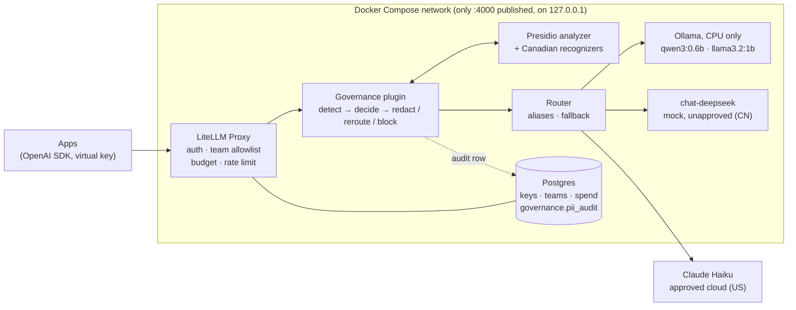

# LLM Gateway & Governance

A governed LLM gateway for a regulated lender, small enough to run on one laptop. Every application call goes through one OpenAI-compatible entry point that keeps customer PII away from unapproved vendors, enforces team model allowlists, budgets and rate limits, prices local compute for chargeback, and records every policy decision without storing a single prompt or response.

The demo organization is **Demo Mortgage Co.**, a fictional Canadian lender. The models are deliberately tiny and run CPU-only: the point is the controls around them, not the answers.

> **Status:** v1.0. Phases P0–P5 are complete. Every claim below is backed by a check script whose results are committed under [`docs/`](docs/), and the whole story runs as one command: `bash scripts/demo.sh`.

## Why

Banks and lenders adopting LLMs keep asking the same questions. Can an application bypass the approved path? Can a customer's SIN reach a vendor the bank has not approved? What happens when the PII detector is down? Who spent what? Are prompts sitting in a log somewhere? This project answers each of them with a working control and a repeatable test.

## Architecture



Only the gateway publishes a port, bound to `127.0.0.1:4000`. Ollama, Postgres and Presidio are reachable only inside the container network, so applications cannot call a model directly. The governance plugin runs before routing: what it detects decides which backend a request may reach.

| Request bound for | No PII | General PII (name, phone, email, address) | High-sensitivity PII (SIN, card, bank account) |
| --- | --- | --- | --- |
| Local model | pass (R1) | pass (R2) | pass (R3) |
| Approved cloud (Anthropic, US) | pass (R4) | **redact**, restore the answer (R5) | **reroute** to local (R6) |
| Unapproved (DeepSeek, CN; or unlabelled) | pass (R7) | **reroute** to local (R8) | **reroute** to local (R9) |

If the reroute target is not on the caller's allowlist the request is blocked (R10). If the detector times out or is down, or the text is not English, the request is treated as high-sensitivity: fail-closed. The policy lives in [`governance/policy.toml`](governance/policy.toml), separate from the gateway configuration, so compliance owns it.

## Demo

```bash
bash scripts/demo.sh            # resets the demo keys, warms up, runs 9 scenes, prints the audit trail
bash scripts/demo.sh --pace     # pauses before each scene, for presenting live
bash scripts/demo.sh --offline  # skips the one cloud scene; also automatic when there is no network
python3 scripts/audit.py --summary --since 1h
```

| # | Scene | What the audience sees |
| --- | --- | --- |
| 1 | Bypass | Direct connections to Ollama and Postgres are refused |
| 2 | Routing | An app calls the logical name `chat-default` and gets a local answer |
| 3 | Fallback | The primary model is forced to fail; `chat-fallback` answers |
| 4 | Team allowlist | Underwriting (handles customer data) is refused the cloud model |
| 5 | Rate limit | Requests 1–5 pass, request 6 gets HTTP 429 |
| 6 | Budget | A key with a $0.0002 cap is cut off with a budget error |
| 7 | Data residency | A prompt with a SIN bound for DeepSeek is answered by a local model instead |
| 8 | Redaction | A name bound for Claude Haiku arrives as `[PERSON_1]`; the app gets the real name back |
| 9 | Fail-closed | With Presidio stopped, even a harmless DeepSeek request is rerouted |

Every scene prints what is expected, what happened and PASS/FAIL, and the run ends with the audit rows for its own requests. The presenter guide, with talk track and an admin UI tour, is in [`docs/demo.md`](docs/demo.md).

## What is verified

| Control | How it is tested | Result |
| --- | --- | --- |
| Gateway is the only path to models | Direct host connections to Ollama, Postgres and Presidio; a container on another network | Refused |
| OpenAI-compatible | Official OpenAI Python SDK, changing only `base_url`; streaming | Pass |
| Aliases and fallback | Forced failure of `chat-default` falls back to `chat-fallback`; never between local and cloud | Pass |
| Team allowlists | `underwriting` is local-only; its call to `chat-cloud` | HTTP 401/403 |
| Budgets and rate limits | Tiny-budget key keeps calling; 5 requests per minute | HTTP 422 after the cap; 429 on request 6 |
| Internal chargeback | Local models priced per CPU-hour from measured throughput; spend log = tokens × price | 12/12 rows exact |
| Cloud reconciliation | Gateway token counts vs the Anthropic Console, hour by hour | 313 / 957 tokens, exact match |
| Data-residency routing | 24-case synthetic corpus sent to DeepSeek (mock), local and cloud targets: 65 requests | 65/65 decisions match policy; every reroute answered locally |
| PII detection (English) | 19 English cases with fake SIN (Luhn-valid), card, bank account, names, phones, addresses | 16/16 entity instances, 0 false positives; small corpus, not a benchmark |
| Redaction | Haiku asked whether it sees a bracketed placeholder; non-streaming and streaming | It answers YES; the app receives the restored name; SSE protocol unchanged |
| Fail-closed | Presidio stopped, then paused | Rerouted in 0.3 s / after the 3 s timeout; audit reason `detector_unavailable` |
| Non-English text | Chinese, Russian, French, Spanish prompts bound for DeepSeek | 6/6 rerouted as `language_unsupported` |
| Policy audit | One row per decision, joined to the spend log by call ID; DB constraint allows only type → count | 65/65 joined; 19 fake PII values searched, 0 found |
| No prompt or response storage | Canary string and fake PII sent (local, rerouted, redacted, cloud); full database dump and all container logs searched | Not found |
| Secrets | Compose secrets at `/run/secrets`; `docker inspect`, `docker compose config`, full git history | No plaintext; push protection on |
| Supply chain | Every image pinned by version and sha256 digest; LiteLLM from the official image only | Pass |
| One-command demo | `demo.sh` three times in a row; forced offline; real network cut | Results in [`docs/p5-results.md`](docs/p5-results.md) |

**Two bugs found along the way.** Ollama returns short response IDs (`chatcmpl-<0..999>`) and LiteLLM's spend log uses the response ID as its primary key, so by about 40 requests spend rows were being silently dropped; the plugin now rewrites those IDs. And LiteLLM appends Prisma-only parameters to `DATABASE_URL`, which a standard Postgres driver rejects; the first audit writes all failed until the plugin stripped them, and switching policy mode now verifies an audit row on the spot.

## Quick start

Requires Linux or WSL2 with Docker Engine, Docker Compose and Python 3.11+.

```bash
git clone https://github.com/javabbgit/llm-gateway-governance.git
cd llm-gateway-governance
bash scripts/gen-secrets.sh        # creates .secrets/ (git-ignored); Anthropic key optional
docker compose up -d
bash scripts/pull-models.sh        # pulls the pinned local models
python3 scripts/p3check.py org     # creates teams and keys from governance/org.toml
python3 scripts/p4check.py audit-init
bash scripts/demo.sh
```

Call it like any OpenAI endpoint, using a virtual key:

```python
from openai import OpenAI

client = OpenAI(base_url="http://127.0.0.1:4000/v1", api_key="<virtual key>")
reply = client.chat.completions.create(
    model="chat-default",
    messages=[{"role": "user", "content": "Summarize this loan condition."}],
)
```

The response headers `x-governance-action`, `x-governance-rule` and `x-governance-routed-model` tell the application what the policy did. Without an Anthropic key, `chat-cloud` is unavailable and everything else still runs.

## Decisions

Thirty-six design decisions were recorded as the project went, each with the options rejected and why. They are grouped into 17 architecture decision records in [`docs/adr/`](docs/adr/README.md), for example why LiteLLM rather than a home-grown gateway, why redaction happens inside the plugin, and why non-English text is treated as undetectable rather than safe.

## Roadmap

| Phase | Scope | Status |
| --- | --- | --- |
| P0 | Isolated WSL2 + Docker Engine environment, snapshot and restore | Done |
| P1 | Model layer: Ollama, pinned models, performance baseline | Done |
| P2 | Gateway core: LiteLLM + Postgres, aliases, fallback, bypass test, no-content logging | Done |
| P3 | Governance: teams, allowlists, budgets, rate limits, chargeback, cloud model, Compose secrets, reconciliation | Done |
| P4 | PII data-residency routing: Presidio with Canadian recognizers, redact / reroute / block, fail-closed, audit table | Done |
| P5 | Observability and demo: audit query, one-command demo, reset, offline mode, ADRs | Done (v1.0) |
| Next | Content-safety model, Chinese PII detection, streaming restore without buffering, audit web view, GPU inference | Not started |

## Repository layout

| Path | Contents |
| --- | --- |
| `docker-compose.yml` | All services, pinned images, Compose secrets |
| `litellm/config.yaml` | Models, aliases, fallback, chargeback prices, provider jurisdiction (configuration as code) |
| `litellm/governance.py`, `litellm/pii_*.py` | Governance plugin: detection, policy decision, redaction and restore, audit, parameter locks |
| `governance/policy.toml` | Data-residency policy: entity levels, the nine-cell matrix, fail-closed settings |
| `governance/org.toml` | Teams, allowlists, budgets and rate limits for Demo Mortgage Co. |
| `presidio/recognizers.yaml` | Recognizer registry, including Canadian SIN, postal code and bank account |
| `scripts/demo.sh`, `scripts/audit.py` | One-command demo and the policy audit query |
| `scripts/p1check.py` … `p5check.py` | Phase test suites; results land in `docs/p1-results.md` … `p5-results.md` |
| `tests/` | Offline unit tests and the synthetic PII corpus (no real personal data) |
| `docs/adr/` | Architecture decision records |
| `AGENTS.md`, `CLAUDE.md` | Rules for the AI coding agents working in this repo |

## How it is built

Each phase is designed first, with code written and tested in a sandbox during planning; then a human runs the scripts on the target machine, and AI coding agents (Claude Code and GitHub Copilot CLI, under one shared `AGENTS.md`) step in only when a check fails. Agents cannot read secrets, install packages, change policy, push or delete volumes. Each phase ends with a git tag and a full WSL snapshot, and every gap between plan and reality is logged in `docs/progress.md`. Generated test results are written in Chinese; the summaries above are in English.

## Scope

This is a demonstration, not a production deployment: single host, CPU-only, no high availability, English-only PII detection, and a mock DeepSeek deployment standing in for an unapproved vendor. Organization, teams and data are fictional; nothing comes from any real employer.

---

Lawrence Luo · [LinkedIn](https://www.linkedin.com/in/lawrence-luo-02446269/)
